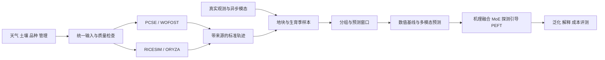

# 根据研究报告制定的实现计划

## 目标与先后顺序

最终任务是：截至观测日的遥感、近地视觉、天气、土壤、管理和表型，加上未来天气与管理情景，直接预测未来多变量生长轨迹。机理模型提供可解释基线、辅助轨迹与同化载体；多模态骨干、MoE 和探测引导 PEFT 在可验证的数据闭环之上实现。

当前没有真实项目数据，先以来源明确的工程演示跑通数据流，后续保持统一契约替换输入。优先完成能够独立验收的模块，复杂模型逐项加入，分别验证贡献。

## 阶段 0：可运行工程起点（本版）

- 锁定 PCSE、RICESIM 和水稻参数仓库，建立项目虚拟环境和统一命令入口。
- 实现 WOFOST 7.2 PP 水稻模拟；人工天气与默认土壤仅用于工程验证。
- 统一逐日 LAI、地上部干物质、贮藏器官干物质与原生 DVS，标注模拟来源。
- 先划分生育季，再生成历史/未来窗口；未来目标不进入输入，标准化只拟合训练集。
- 以持续性和直接多步岭回归作为初始基线，导出逐变量、逐提前量指标和运行溯源。
- 建立 ORYZA 缺项检查、独立进程入口与原生日表转换。真实引擎未完成运行时明确报告状态。

验收：默认 12 个生育季闭环成功，产出可检查的轨迹、划分、预测和指标；核心行为测试通过。

## 阶段 1：完善双机理引擎与批量情景

PCSE 先使用已有水稻参数与潜在生产模型。涉及缺水、灌溉、施肥时，分别选择与校验适用的水分/氮过程版本，核对参数是否匹配；不得把 PP 下不产生作用的管理字段当成有效处理。稻田淹水和水氮胁迫优先用经验证的水稻专用过程描述。

ORYZA 首先补齐 `CONTROL.DAT` 引用的品种 `.crp`、土壤、管理和 rerun 文件，以及可复现构建说明。检查附带静态库目标平台、工具链和缺失工具库源码，确认可用构建路线后在项目环境实现。若只能使用已有可执行程序，保留独立进程接口及运行平台记录。逐日 `RES.DAT` 按实际格式解析，不能用 `op.dat` 季末汇总冒充日序列。

随后加入批量场景管理：天气、品种、播栽期和适用管理条件；每个场景单独运行目录，缓存键包含引擎提交、输入内容、参数和随机种子，失败保留日志。不同品种使用同一天气便于配对比较，不能据此将同一来源的派生场景随机拆入多个数据集。

验收：每个引擎各有一个可重跑的参考案例、变量单位表和关键阶段对照；不支持的变量带可用性标识，不补造株高或胁迫标签。

## 阶段 2：真实数据对齐、标定与同化

以地块—生育季为主键导入真实数据；最小输入包括地点、品种、播栽/出苗日期、逐日天气和可用土壤参数。LAI、生物量、抽穗日期或季末产量可稀疏提供；每条观测保留日期、单位、质量、来源与可获取时刻。

先做参数敏感性分析，只校准少量可辨识参数，校准数据严格限制在训练年份/地点。评估原始机理模型与校准机理模型，再在 PCSE 上建立 LAI 集合同化原型。状态更新必须经模型支持的写接口保持叶面积、叶重及相关状态一致，不能直接篡改内部变量。ORYZA 若缺状态读写或重启机制，先通过参数重跑实现观测条件更新，逐日同化留待接口验证。

验收：固定预测截止日，仅使用届时已可获取的观测；比较无同化/同化模型，检查状态更新、残差和未来轨迹，不用测试季后观测反推预测起点。

## 阶段 3：数值长序列与机理增强

扩展 LSTM、GRU-D、PatchTST、TimeXer 等数值基线，优先实现一个标准时序模型与一个缺失感知模型。历史状态和未来天气/管理分别编码，采用直接多步解码。

依次增加：积温/VPD/累积辐射等派生量、机理轨迹辅助监督、同化状态、物候及范围软约束。每次只增加一组机制，保持划分一致。真实观测监督与模拟监督分开计数和加权。

验收：持续性、纯机理、纯数据驱动与机理增强模型在相同截止日/预测期上比较；同时统计物候倒退、负值、阶段冲突等规则违反率。误差下降与规则改善分别报告。

## 阶段 4：异步多模态预测

卫星影像、无人机和近地视觉保留真实时间戳与采样间隔，管理数据使用事件表示。统一记录空间位置、模态、来源、可用掩码和质量；不把插值结果当作真实每日图像观测。

先增加一种视觉模态，使用冻结编码器和轻量适配器，通过历史状态融合与未来情景交叉注意力接入预测主干，再增加其他模态。训练窗口可以使用日网格，而异步观测本身不强制补齐。

验收：单模态与多模态、规则插值与异步输入、来源权重与质量掩码各有对照；缺失模态时仍可执行。生成图像仅在有明确需求与可验证数据来源后加入。

## 阶段 5：MoE 与探测引导 PEFT

先验证共享骨干与少量轻量专家，再研究品种、生态区、管理或阶段路由。加入负载均衡，记录实际激活参数量。

将已完成的 Pre-PEFT Probing 工作迁移到农业任务：权重统计、谱特征、扰动敏感性；在同一骨干、同一划分及相同参数预算下，对比固定层、随机层、均匀分配和探测选层。逐步接入 LoRA、VeRA、IA3、LayerNorm-Tuning 与 Partial-Tuning，记录适用模块，不假定每种方法适用于所有层。

验收：跨种子比较预测误差、探测开销、训练时间、峰值显存和少样本适配收益；探测成本计入总训练成本。PEFT 与 MoE 各自设消融，避免无法归因。

## 阶段 6：泛化、解释与部署

- 数据协议：LOYO、LOLO、样本允许时 LOVO；同一原始生育季及其模拟/生成派生样本绑定分组，处理同地点跨年记忆的边界。
- 未来条件：实况回放、可获取预报和多情景预测分开评测；冻结预测发起时刻可获得的信息。
- 不确定性：分位数预测与独立生育季校准集，报告覆盖率及区间宽度。
- 解释：模态与时间窗口遮蔽、管理/天气反事实、农学一致性与案例复核。
- 成本：剪枝、量化、蒸馏分别报告误差、时延、显存和能耗；明确设备、批大小与测量条件。

报告中的误差 15%、训练参数降低 25%、部署成本降低 3 倍作为后续对照目标；接入真实数据后先固定各指标分母、基线及设备口径，再进行实验验证。

## 真实数据到达后需确认的最少信息

数据路径与可用范围、地块/季节主键、地点和年份、品种、播栽/出苗日期、天气单位、土壤与管理字段、目标指标定义及测量日期。只有季末产量时先开展季末任务，不虚构完整生长轨迹真值。
